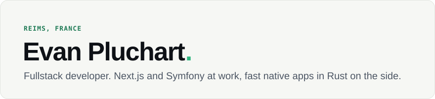

<picture>
  <source media="(prefers-color-scheme: dark)" srcset="assets/header-dark.svg">
  
</picture>

I build web products at [KOUL](https://www.koul.io) with Next.js and Symfony. On the side, I make small desktop apps that open instantly, work offline and stay light on memory.

### Desktop apps

| | |
|---|---|
| **[Vigie](https://github.com/EvanPluchart/vigie)** | A task manager for Windows, macOS and Linux that tells you why your computer is slow, using under 1 % of a core. Rust, Slint. [Website](https://evanpluchart.github.io/vigie/) · [Download](https://github.com/EvanPluchart/vigie/releases/latest) |
| **[Recto](https://github.com/EvanPluchart/recto)** | A fast, offline PDF viewer and editor for Windows, macOS and Linux. Rust. |
| **[Windows Finder](https://github.com/EvanPluchart/windows-finder)** | The macOS Finder for Windows: icon, list, column and gallery views, tabs, Quick Look, tags. Rust, GPUI. [Website](https://evanpluchart.github.io/windows-finder/) |
| **[Clippy](https://github.com/EvanPluchart/Clippy)** | A fast, private, keyboard-first clipboard history for macOS. Swift. [Website](https://clippy.evanpluchart.fr) |

### Web and tools

| | |
|---|---|
| **[Kyomu](https://github.com/EvanPluchart/kyomu)** | A light, modern, self-hosted comics and manga reader, an alternative to Komga. TypeScript. |
| **[claude-code-status-line](https://github.com/EvanPluchart/claude-code-status-line)** | A status line for Claude Code. Go. |
| **[homebrew-tap](https://github.com/EvanPluchart/homebrew-tap)** | My apps for Homebrew: `brew tap EvanPluchart/tap`. |

### Stack

Next.js · React · TypeScript · Symfony · PHP · Rust · Swift · Go

---

[evanpluchart.fr](https://www.evanpluchart.fr/)
